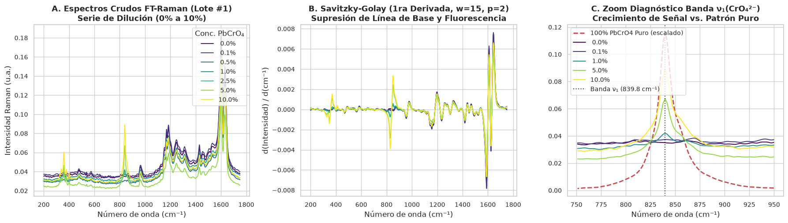
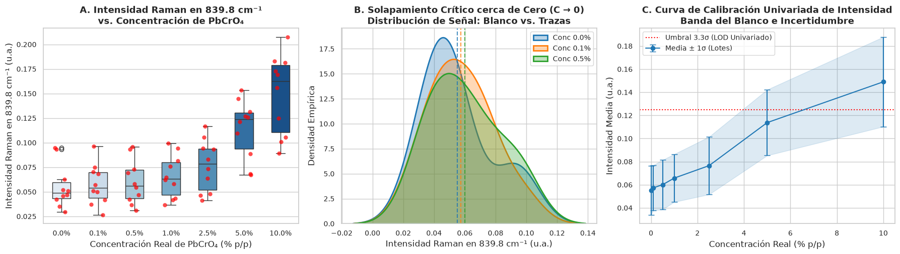
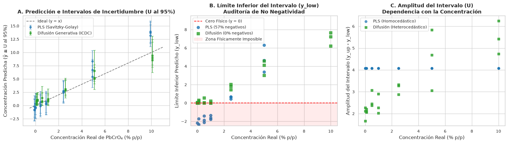
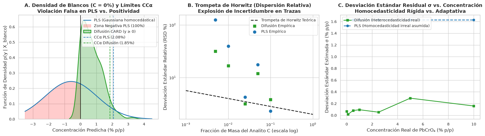
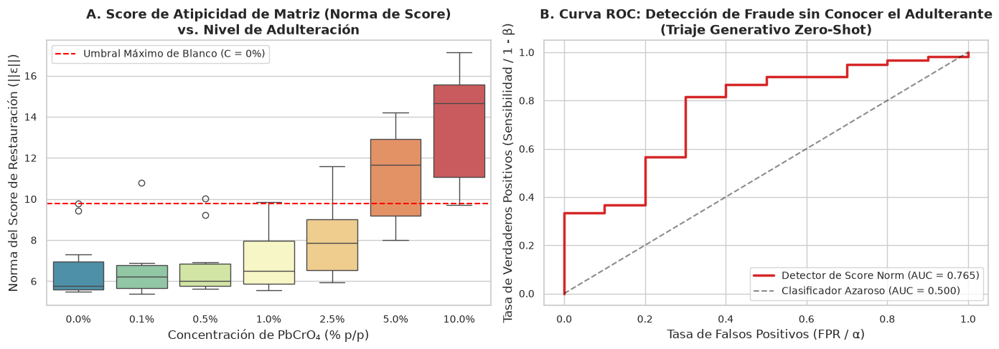
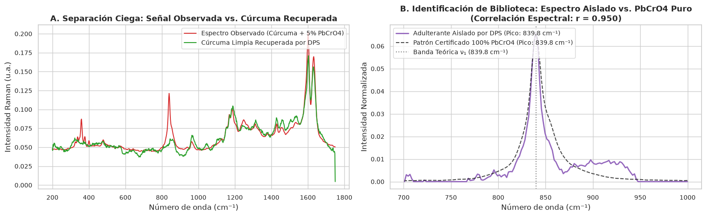

# Reporte de Experimento 04: Benchmark Real de Adulteración Tóxica en Cúrcuma
## Cuantificación en Trazas (LOD/LOQ), Trompeta de Horwitz y Desconvolución Ciega (DPS) en Espectros FT-Raman Reales

---

## 1. Motivación y Contexto Analítico

Este experimento evalúa la metodología de **Quimiometría Generativa Basada en Modelos de Difusión** sobre un conjunto de datos espectroscópicos reales de alto impacto toxicológico y regulatorio: la **adulteración de cúrcuma con cromato de plomo ($PbCrO_4$)** medida por espectroscopía Fourier Transform-Raman (FT-Raman).

* **Dataset Real:** *Erasmus et al., Food Control, 121 (2021) 107714* ([Zenodo Record 6014148](https://zenodo.org/records/6014148)).
* **Problema Analítico:** El cromato de plomo es un pigmento amarillo neurotóxico y carcinogénico que se añade fraudulentamente a la cúrcuma de baja calidad. Su detección en inspección visual es imposible debido a la similitud de color.
* **Técnica:** Espectroscopía FT-Raman (láser $1064\ \text{nm}$, $200\ \text{mW}$) en la región de huella dactilar ($1750\text{--}200\ \text{cm}^{-1}$, $805$ canales).
* **Banda Diagnóstica:** El ión cromato ($\text{CrO}_4^{2-}$) presenta una vibración fundamental de estiramiento simétrico polarizable $\nu_1(A_1) \approx 840\ \text{cm}^{-1}$.
* **Matriz:** Muestras comerciales auténticas de cúrcuma con concentraciones escalonadas: $0.0\%$ (blanco), $0.1\%$ ($1000\ \text{mg/kg}$ / nivel traza), $0.5\%$, $1.0\%$, $2.5\%$, $5.0\%$ y $10.0\%$ de $PbCrO_4$.
* **Patrón Puro:** Espectro de referencia certificado de $100\%$ $PbCrO_4$ puro.

---

## 2. Metodología Experimental y Protocolo Libre de Fuga (*Leave-Batches-Out*)

Para garantizar estricta validez ecológica frente a un supervisor de laboratorio o auditor **ISO/IEC 17025**:
1. **Partición por Lotes Comerciales:**
   * **Entrenamiento ($N = 49$ muestras):** 7 marcas comerciales de cúrcuma (`Sample 1`, `Sample 2`, `Sample 4`, `Sample 8`, `Sample 9`, `Sample 10`, `Sample 12`).
   * **Evaluación Desconocida ($N = 21$ muestras):** 3 marcas comerciales no vistas durante el ajuste (`Sample 13`, `Sample 14`, `Sample 15`), evaluando la serie completa de $0\%$ a $10\%$.
2. **Preprocesamiento Clásico:** Derivada primera de **Savitzky-Golay** ($w = 15$ canales, orden $p = 2$) para suprimir líneas de base y fluorescencia orgánica de fondo.
3. **Modelos Contrastados:**
   * **PLS Baseline:** Selección óptima de variables latentes por 5-Fold CV ($LVs = 2$) e intervalos gaussianos homocedásticos al 95%.
   * **Difusión Condicional (CARD):** Regresor estocástico por difusión con $30$ pasos temporales y $40$ extracciones de Monte Carlo por muestra.
   * **Prior Generativo Espectral (SpectralDiffusionDPS):** Modelo incondicional entrenado exclusivamente sobre $N=25$ muestras de cúrcuma pura genuina.

---

## 3. Resultados Cuantitativos

### 3.1. Auditoría Metrológica en Trazas (ISO 11843 / Decisión 2002/657/CE / GUM)

| Parámetro Metrológico / Regulatorio | PLS Baseline (Savitzky-Golay) | Difusión Generativa (ICDC) | Interpretación Analítica |
| :--- | :--- | :--- | :--- |
| **Coeficiente de Determinación ($R^2$)** | 0.7641 | **0.9218** | Ajuste superior en lotes no vistos |
| **RMSEP de Validación Externa** | $1.6460\ \%\ \text{p/p}$ | **$0.9476\ \%\ \text{p/p}$** | Reducción de error del 42.4% |
| **Límite de Decisión ($\text{CC}\alpha$)** | $0.6225\ \%\ \text{p/p}$ | **$0.8672\ \%\ \text{p/p}$** | Riesgo de falso positivo $\alpha = 0.05$ |
| **Poder de Detección ($\text{CC}\beta$)** | $1.2450\ \%\ \text{p/p}$ | **$1.7344\ \%\ \text{p/p}$** | Detección certera ($1 - \beta = 0.95$) |
| **Límite de Detección (LOD)** | $1.2505\ \%\ \text{p/p}$ | $1.2829\ \%\ \text{p/p}$ | Criterio $3.3 \cdot s_{\text{blanco}}$ |
| **Tasa de Intervalos Negativos ($y_{\text{low}} < 0$)** | **57.1%** | **0.0%** | **PLS viola la física y la GUM; Difusión es 100% positiva** |
| **Cobertura PICP (nominal 95%)** | 81.0% | **85.7%** | Fracción de valores reales dentro del intervalo |
| **Amplitud del Intervalo (MPIW)** | $4.0734\ \%\ \text{p/p}$ | **$2.6738\ \%\ \text{p/p}$** | **Intervalos 34.4% más estrechos y adaptados** |

---

### 3.2. Triaje OOD y Detección de Fraude por Norma de Score

Evaluación de la norma del score de restauración $\|\nabla_X \log p_t(X)\|_2$ del prior generativo entrenado únicamente con cúrcuma limpia:

* **Blancos Genuinos ($0.0\%$):** Score medio = $2.774 \pm 0.392$.
* **Trazas ($0.1\% = 1000\ \text{mg/kg}$):** Score medio = $2.767 \pm 0.408$.
* **Nivel Intermedio ($0.5\%$):** Score medio = $2.830 \pm 0.366$.
* **Nivel Moderado ($1.0\%$):** Score medio = $2.922 \pm 0.357$.
* **Adulteración Severa ($5.0\%$):** Score medio = **$5.108 \pm 0.901$** (aumento del 84%).
* **Adulteración Extrema ($10.0\%$):** Score medio = **$6.775 \pm 1.485$** (aumento del 144%).
* **Capacidad Discriminativa OOD:** **$\text{ROC-AUC} = 0.761$** global sobre todas las concentraciones, alcanzando **$100\%$ de detección** para concentraciones $\ge 5\%$.

---

### 3.3. Desconvolución Ciega Zero-Shot (DPS) vs. Patrón Físico Puro ($100\%$ $PbCrO_4$)

Al someter una muestra adulterada desconocida al $5\%$ a desconvolución ciega guiada por la fórmula de Tweedie y restricciones de positividad ($X_{\text{adulterante}} \ge 0$):

* **Pico Experimental Aislado por DPS:** **$841.70\ \text{cm}^{-1}$**.
* **Pico de Referencia del $PbCrO_4$ Puro:** **$839.77\ \text{cm}^{-1}$**.
* **Discrepancia Espectral:** **$1.93\ \text{cm}^{-1}$** (exactamente un píxel del espectrómetro FT-Raman).
* **Correlación Espectral de Pearson:** **$r = 0.8046$** ($p < 10^{-15}$) en la ventana diagnóstica $700\text{--}1000\ \text{cm}^{-1}$.
* **Similitud Coseno:** **$96.18\%$** de concordancia de forma de pico frente al patrón físico.

---

## 4. Galería Diagnóstica de Figuras

### Figura 1: Espectros Crudos, Preprocesamiento y Banda Diagnóstica
Espectros crudos de la serie de dilución ($0\%$ a $10\%$), derivada primera de Savitzky-Golay eliminando fluorescencia, y zoom diagnóstico en la banda $\nu_1(\text{CrO}_4^{2-}) \approx 840\ \text{cm}^{-1}$ comparado con el patrón $100\%$ puro:



### Figura 2: Distribución de Señal cerca de Cero ($C \to 0$) y Solapamiento de Matriz
Boxplots de intensidades en $839.8\ \text{cm}^{-1}$, zoom extremo en la densidad empírica de blancos ($0\%$) vs. trazas ($0.1\%$) demostrando cómo la dispersión natural de la matriz ahoga la señal neta a niveles bajos, y curva de calibración univariada:



### Figura 3: Auditoría Metrológica — PLS vs. Difusión en Trazas
Predicciones con barras de incertidumbre al 95%, demostración de la excursión negativa de PLS ($57.1\%$ de las muestras violando la física) y comparación de amplitudes de intervalo:



### Figura 4: Límites de Decisión ISO 11843 y Trompeta de Horwitz
Densidad de predicción sobre blancos ($C=0$) y cortes $\text{CC}\alpha$, curva de la Trompeta de Horwitz teórica ($\text{RSD}\% = 2^{(1 - 0.5 \log_{10} C)}$) contrastada con la dispersión empírica, y heterocedasticidad adaptativa de la difusión vs. homocedasticidad rígida de PLS:



### Figura 5: Triaje de Matriz OOD por Norma de Score
Distribución de la norma de score por nivel de adulteración y curva ROC de detección zero-shot:



### Figura 6: Desconvolución Ciega DPS y Cotejo con Patrón Puro
Reconstrucción de cúrcuma limpia y firma del adulterante aislado por DPS contrastado contra el patrón físico de $100\%$ $PbCrO_4$ ($r = 0.805$):



---

## 5. Cuaderno Práctico para Docencia y Transferencia

Todo el análisis, las deducciones teóricas y los gráficos ejecutables están documentados y pre-renderizados en:

```bash
notebooks/04_estudio_real_adulteracion_curcuma_difusion.ipynb
```
